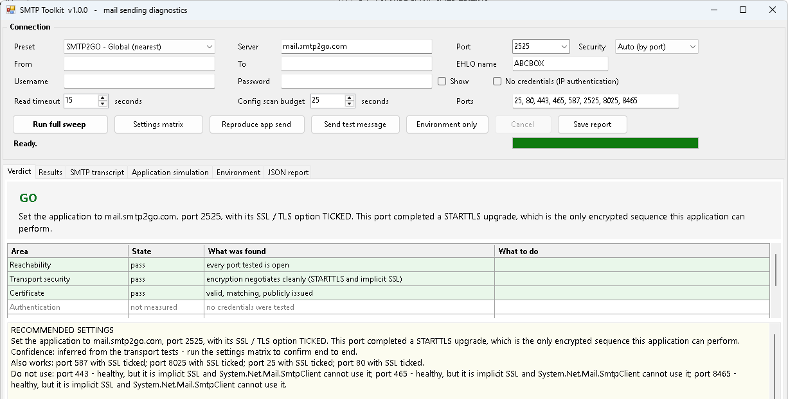

# SMTP Toolkit

A single-file **Windows PowerShell 5.1** WinForms tool for the ticket that says *"the app can't send email any more"*. It answers the question a port test can't: **will this application, with these settings, on this machine, actually send?**

From [ihavenoram.com](https://ihavenoram.com): field notes for ADHD techs running managed services.



```
Launch-Smtp-Toolkit.cmd    <- run this
Smtp-Toolkit.ps1           <- the tool, one self-contained file
```

## Download

Grab the latest zip from **[Releases](../../releases/latest)**. The SHA-256 checksum is in the release notes and in the `.sha256` file beside the zip:

```powershell
Get-FileHash .\SMTP-Toolkit.zip -Algorithm SHA256
```

Run it with the launcher. WinForms needs `-STA`, and the launcher supplies it:

```bat
Launch-Smtp-Toolkit.cmd
```

Add `-NoHideConsole` to watch for errors. No admin rights needed; a few environment checks report less without them and say so. Built to run in a ScreenConnect Backstage session, including as SYSTEM.

---

## Why it exists

An application set up for an SMTP relay on **port 465** timed out on every send. DNS was fine. Every one of the relay's ports was open. Implicit TLS on 465 worked. STARTTLS on 2525 worked. Every network test passed, and the app still couldn't send.

The app used **`System.Net.Mail.SmtpClient`**, which only ever speaks **STARTTLS**: connect in plain text, read the server's greeting, then upgrade. On an implicit-TLS port like 465 the server sends nothing until the client starts a TLS handshake, and the client sends nothing until it gets a greeting. Both sides wait politely until the app gives up with *"The operation has timed out."*

A port test can't see that, and neither can `Test-NetConnection`; both report 465 as healthy. So this tool layers its checks:

| Question | What it checks |
| :--- | :--- |
| **Can we reach it?** | DNS (including hosts-file overrides), the whole port matrix, latency |
| **Is the transport sound?** | Implicit TLS, STARTTLS, which TLS versions negotiate, certificate chain, signs of TLS interception |
| **Will it accept us?** | AUTH, then `MAIL FROM` / `RCPT TO` **without delivering anything**, which proves the sender is allowed |
| **Will the *application* work?** | A real `System.Net.Mail.SmtpClient` send, plus a port × "Use SSL" matrix, because that's the actual question |

## The buttons

- **Run full sweep**: everything above, then a plain-English **Verdict** (GO / NO GO) with the exact settings to type into the application, what else works, and what to avoid and why.
- **Settings matrix**: tries every port with the SSL box ticked and unticked, the way the application would.
- **Reproduce app send**: sends one real test message through `SmtpClient`, the same class most Windows line-of-business apps use.
- **Send test message**: a raw SMTP send with a full transcript.
- **Environment only**: .NET version and TLS registry settings, security software, firewall, proxy, and a scan of application `.config` files for a `<mailSettings>` block that silently overrides the app's own settings screen.
- **Save report**: everything measured, as JSON (`smtp-diagnostic v1` schema), ready to attach to a vendor ticket.

Presets cover SMTP2GO (each region), Microsoft 365 and Google Workspace, plus a custom server. Application profiles explain what the sending app can and can't do, and the checklist of things that make **correct settings look ignored**: settings caches, a second "Send Test" button, a provider dropdown that overrides your fields.

## Honest about its limits

Every result records **how** it was arrived at (`measured`, `server-reported`, `inference`, `registry`, `not measured`), and every section that didn't run says why. The tool also lists its own false negatives in the report. For example:

- Tests run as **this** user on **this** machine. A service or scheduled task can have a different proxy, certificate store or TLS setting.
- A pass means the server **accepted the envelope**, not that the message was delivered. Filtering and reputation act later.
- TLS interception is **inferred** from the certificate issuer and chain, not proven.

## Privacy and safety

- **Credentials** are typed in for the session only. They never reach the transcript, the JSON or any file, and the transcript redacts AUTH lines.
- **Nothing is delivered** unless you press *Reproduce app send* or *Send test message*, or switch the settings matrix to live sends. The envelope test and the default matrix reset the session before `DATA`, so no message is handed over.
- **Read only** on the machine: TLS and .NET registry values are reported, never changed, because they affect every .NET application on the box.
- To compare this site's public IP with the one the mail server sees (for IP-authenticated relays), the tool asks public "what's my IP" services: `api.ipify.org`, `checkip.amazonaws.com` and `ifconfig.me`.

## Requirements

- Windows with **Windows PowerShell 5.1** (built in to Windows 10/11 and Server 2016+)
- Outbound access to the mail server you're testing

## About

Built with AI assistance (Claude) for a real MSP support job. It's provided as is, with no warranty: read what it does before you run it, and check how your EDR will react to a tool that probes ports and opens TLS connections.

MIT licensed; see [LICENSE](LICENSE).
